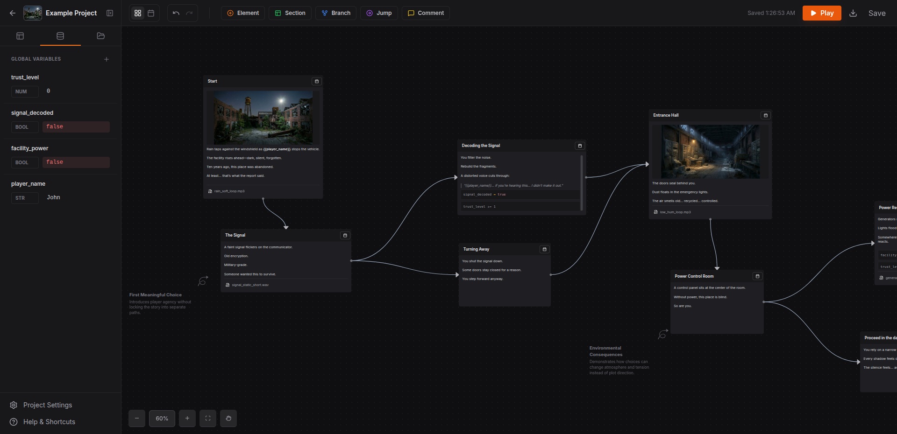

# NodeTale

A visual node-based story editor for creating interactive branching narratives. Available as both a web app and desktop application.



## Features

- **Visual Node Editor** – Scenes, branches, jumps and Set values nodes on a canvas (ReactFlow)
- **Rich Text Scenes** – Inline editor with logic blocks, `{{expressions}}` and media
- **Logic Language** – `if / else`, `a ? b : c`, `random()`, `chance()`, math and list helpers, choice conditions and effects
- **Set values** – Change variables without code, or ask the player for a value
- **Play Mode** – Keyboard play, text reveal, status bar, story log, save slots, endings tracker, timed choices
- **Debugger** – Trace of every script line and branch, typed variable editing, restart from a scenario
- **Story Views** – Branch map, timeline and variable analysis (explores every outcome of `random()`)
- **Share & Edit Together** – Send a story with all its media, or edit it live, browser to browser with no server (WebRTC; invite link + reply code). Edit or view-only invites, automatic backups
- **Export/Import** – `.zip` (with or without media) or `.json`

## Tech Stack

| Category | Technologies |
|---|---|
| **Frontend** | React 19, TypeScript, Vite |
| **Desktop** | Electron, electron-vite |
| **UI** | ReactFlow, Tailwind CSS, Lucide Icons |
| **Routing** | React Router 7 |
| **Storage** | IndexedDB (web), File System (desktop) |

## Quick Start

### Prerequisites

- [Bun](https://bun.sh/) or [Node.js](https://nodejs.org/) (v18+)

### Installation

```bash
bun install
```

### Development

```bash
# Web
bun run dev            # Start dev server at http://localhost:3000

# Electron
bun run dev:electron   # Start Electron dev mode
```

### Build

```bash
# Web
bun run build          # Production build to dist/

# Desktop
bun run dist:linux     # Linux AppImage
bun run dist:win       # Windows installer
bun run dist:mac       # macOS DMG
```

### Checks

```bash
bun run check          # typecheck + lint + unit tests + browser tests (run after every change)
bun run test           # unit tests (tests/unit, Vitest)
bun run test:e2e       # browser tests (tests/e2e, headless Chrome/Chromium; CHROME_PATH to choose one)
bun run clean          # Remove build artifacts (dist/, out/)
```

Every build runs the typecheck and unit tests first.

### Hosting

The web app uses plain URLs (`/<story id>`, `/share#…`), so the host must serve `index.html` for every path (`public/_redirects` does this on Netlify). The desktop app shares bare codes unless `VITE_SHARE_ORIGIN` names the web app's address.

## Usage

1. **Create a Project** – Start from the dashboard
2. **Add Nodes** – Drag node types from the sidebar
3. **Connect Nodes** – Draw edges to define story flow
4. **Edit Content** – Double-click nodes for rich text editing
5. **Play Mode** – Test your interactive story
6. **Manage Assets** – Upload media through the asset panel

### Node Types

| Node | Purpose |
|---|---|
| Scene | Story text, media and logic; lines leaving it are the player's choices |
| Branch | Picks a path by itself using conditions |
| Jump | Continues at another scene, even on another board |
| Set values | Changes variables, or asks the player for them |
| Comment | Non-interactive annotations |
| Section | Visual grouping / dividers |
| Annotation | Floating directional labels |

## Project Structure

```
NodeTale/
├── src/                 # React application source
│   ├── components/      # UI components (share/ for sharing UI)
│   ├── core/            # Story engine, logic language, analysis
│   ├── hooks/           # Custom React hooks
│   └── services/        # Storage, sharing and live sessions
├── tests/               # unit/ (Vitest) and e2e/ (browser) tests
├── electron/            # Electron main/preload
├── configs/             # Build configurations
├── scripts/             # Build utilities
└── public/              # Static assets
```

## Contributing

1. Fork and clone: `git clone https://github.com/Kartik-A-Patil/NodeTale.git`
2. Install: `bun install`
3. Develop: `bun run dev`
4. Submit PRs to `main` branch

## License

[GNU General Public License v3.0](LICENSE)